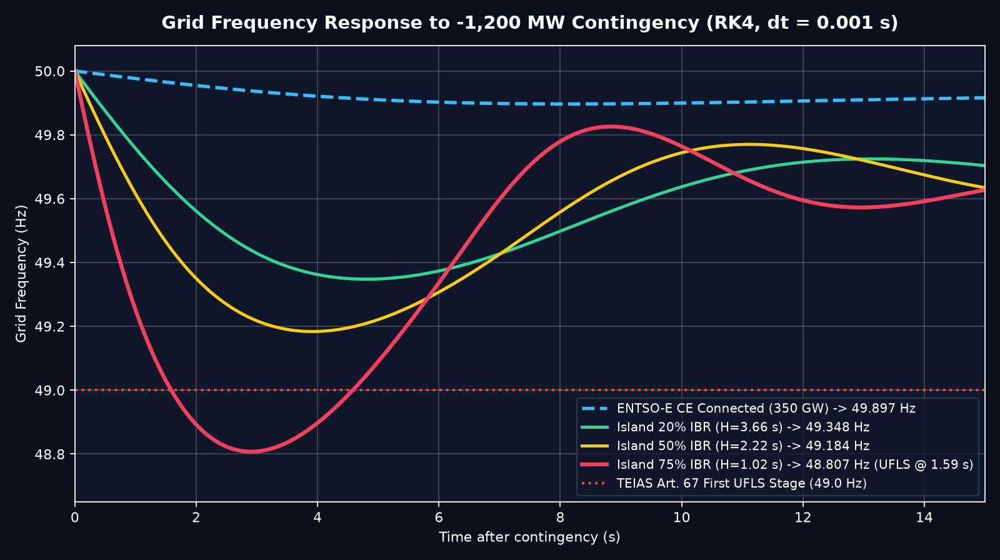
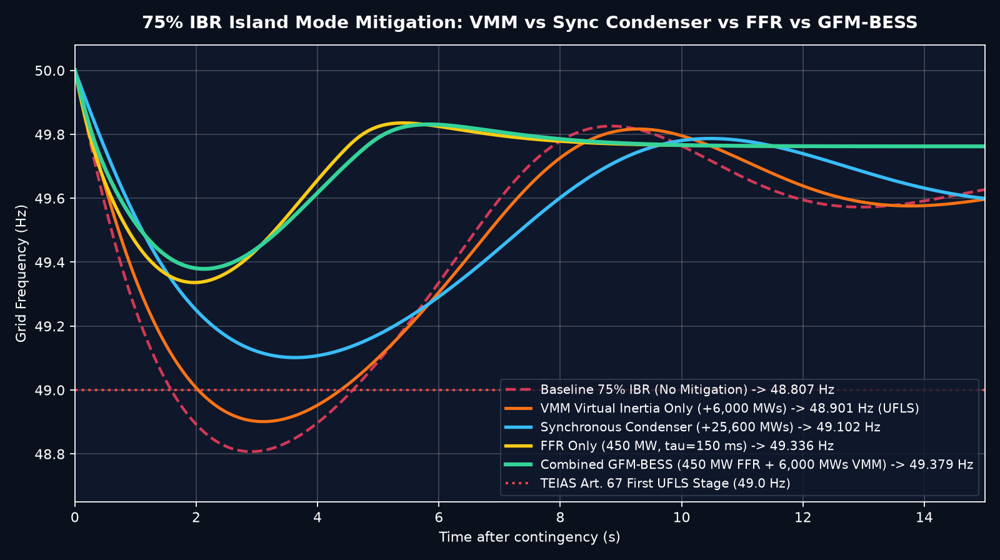

# Grid Inertia, RoCoF & GFM-BESS Frequency Stability Simulator (Devlog #10)

Türkiye elektrik şebekesinde güneş ve rüzgar (IBR — Inverter-Based Resources) payı arttıkça azalan fiziksel dönen kütlenin (**şebeke ataleti**) frekans kararlılığına etkisini inceleyen açık kaynaklı **Python RK4 (`dt = 0.001 s`)** simülasyon modeli.

---

## Fiziksel Model

Tek baralı salınım denklemi (Swing Equation):

$$\frac{2 H_{\text{sys}} P_{\text{base}}}{f_0} \cdot \frac{df}{dt} = \Delta P + P_{\text{gov}}(t) + P_{\text{bess}}(t) + D \cdot P_{\text{base}} \cdot (f_0 - f)$$

- **Post-Trip Atalet Kaybı:** Devre dışı kalan `-1.200 MW` senkron ünitenin kendi dönen kütlesi (`-0,18 s`) arıza anında toplam ataletten düşülür.
- **Mekanik Governor:** `20 mHz` ölü bant, `tau_gov = 4,2 s` mekanik vana gecikmesi ve `1.800 MW` rezerv tavanı.
- **Mevzuat Referansı:** TEİAŞ Şebeke Yönetmeliği Madde 67 (`49,0 Hz` ilk OYO kademesi) ve EirGrid / SONI `%75 SNSP` kısıtı.

---

## Doğrulanan RK4 Sonuçları (`-1.200 MW` Ani Üretim Kaybı)

| Senaryo | $H_{\text{sys}}$ (s) | İlk RoCoF (Hz/s) | Nadir (Hz) | `49,0 Hz` Eşiği | İlk OYO (UFLS) |
|---|---:|---:|---:|---:|---|
| **ENTSO-E CE Bağlı (350 GW)** | `3,48` | `-0,025` | `49,897` | Aşılmaz | False (Güvenli) |
| **Ada Modu %20 IBR (32 GW)** | `3,66` | `-0,256` | `49,348` | Aşılmaz | False (Güvenli) |
| **Ada Modu %50 IBR (32 GW)** | `2,22` | `-0,422` | `49,184` | Aşılmaz | False (Güvenli) |
| **Ada Modu %75 IBR (Önlem Yok)** | `1,02` | `-0,919` | `48,807` | **`1,59 s`** | **True (Yük Atılır)** |
| **Sadece VMM Sanal Atalet (`+6.000 MWs`)** | `1,21` | `-0,776` | `48,901` | `2,03 s` | True (Yetmez) |
| **Senkron Kondansatör (`+25.600 MWs`)** | `1,82` | `-0,515` | `49,102` | Aşılmaz | False (Güvenli) |
| **Sadece FFR (`450 MW`, `tau = 150 ms`)** | `1,02` | `-0,919` | `49,336` | Aşılmaz | False (Güvenli) |
| **Birleşik GFM-BESS (`450 MW FFR + 6.000 MWs VMM`)** | `1,21` | `-0,776` | **`49,379`** | Aşılmaz | **False (En İyi)** |

---

## Simülasyon Grafikleri

### 1. ENTSO-E Bağlı Havuz vs. Ada Modu IBR Taraması


### 2. Çözüm Karşılaştırması: VMM vs. Senkron Kondansatör vs. FFR vs. GFM-BESS


---

## Kurulum ve Çalıştırma

```bash
pip install -r requirements.txt
python simulate.py
```

## Kapsam ve Sınır Koşulları
- Bu model, EirGrid `%75 SNSP` kısıtının yalnızca **atalet ve frekans tepkisi** ayağını tek baralı basitleştirilmiş RK4 modeliyle inceler.
- Dağıtık GES RoCoF/vektör kayması röle açmaları, sistem gücü (SCR) ve hidrolik ünite ters tepkisi (non-minimum phase) ayrı detaylı şebeke modeli gerektirir.

---

### English Summary

Open-source Python RK4 (`dt = 0.001 s`) swing-equation simulator analyzing rotational grid inertia decline under high inverter-based resource (IBR) penetration. Benchmarked against a `-1,200 MW` contingency, TEİAŞ Grid Code Art. 67 (`49.0 Hz` first UFLS stage), and EirGrid `75% SNSP` operational constraints, separating Virtual Machine Mode (VMM) inertia from sub-200 ms Fast Frequency Response (FFR).
